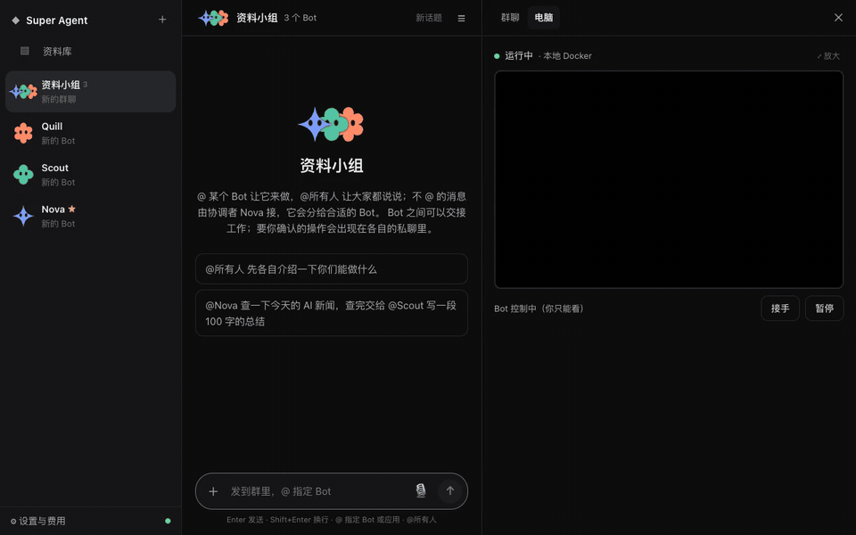

<div align="center">

# open-super-agent

**AI teammate tự host, luôn sẵn sàng: chat, giao việc nền, và có một Computer bạn xem được, nhận quyền điều khiển được.**

Bản remake nguồn mở, thay thế [Grok Bot](https://x.ai/bot). Chọn model theo ý, tính phí theo token. Fork từ [kadaliao/open-super-agent](https://github.com/kadaliao/open-super-agent) với i18n tiếng Việt.

[](https://github.com/kadaliao/open-super-agent/actions/workflows/ci.yml)
[](LICENSE)


**Tiếng Việt** · [English](README.en.md) · [简体中文](README.zh.md)

<a href="docs/images/demo.mp4"></a>

<sub>Group handoff → Teach a task → Library (phần chờ model đã tăng tốc) · <a href="docs/images/demo.mp4">Xem MP4 HD</a></sub>

</div>

## Vì sao làm cái này

Grok Bot dùng rất đã, nhưng đắt và model khóa cứng. open-super-agent bắt chước cách tương tác đó: Bot luôn sẵn, task nền, Computer xem realtime. Kiến trúc lấy cảm hứng từ DeepSeek Super-agent (Router / Worker / Watchdog). Chạy trên máy của bạn — model và chi phí do bạn quyết.

## Tính năng

- 🤖 **Nhiều Bot**: mỗi Bot có tên, avatar, persona và hội thoại riêng; trả lời streaming, phần thinking có thể gập/mở.
- 👥 **Group chat**: 2–6 Bot trong một nhóm. `@` Bot nào Bot đó trả lời, `@everyone` thì tất cả nói; tin không `@` do coordinator nhận rồi phân cho Bot phù hợp. Bot handoff cho nhau (một Bot research xong, giao Bot khác viết tóm tắt). Approval chỉ hiện trong private chat của từng Bot.
- ✉️ **DM giữa các Bot**: không cần group. Bot có thể DM Bot khác nhờ giúp (“nhờ Postman xem có mail Anthropic không”); bên kia làm trong chat riêng, kết quả tự về hội thoại gốc.
- ⚡ **Background task**: việc lâu đưa cho Worker làm nền, bạn vẫn chat tiếp. **Heavy mode** chạy nhiều Worker song song rồi reviewer gộp kết quả.
- 🖥️ **Computer**: mọi Bot dùng chung một Linux desktop (Chromium + terminal). Web điều khiển qua CDP (theo element, đọc text trang) — nhanh và chính xác; xem màn hình live, take over / hand back bất cứ lúc nào; captcha và login thì Bot nhờ bạn làm.
- 🔌 **App market**: chọn app ở sidebar Apps. Notion, flomo, Tencent Docs, DingTalk, TickTick, Todoist… thường one-click + login; Gmail, QQ Mail, Feishu, WeCom, GitHub cần password / token / link; Slack tạo app rồi login; MCP server bất kỳ cũng nối được. Trong chat dùng `@app`. Mỗi app là một manifest — [viết một file rồi mở PR](docs/apps.md) là lên catalog.
- ✅ **Approval & vault**: thao tác ghi hiện card (allow once / deny / always allow), rule quản trong Settings; secret mã hóa, không vào chat log.
- 🧩 **Skills**: gọi `/tên` để tái dùng quy trình; nhờ Bot lưu cách vừa làm thành skill, hoặc sửa ở side panel. **Teach a task**: bạn làm một lần trên Computer, Bot biến recording thành skill draft để duyệt. Export file hoặc share link; người khác dán link là cài; `SKILL.md` (Claude và tương tự) import được.
- 🎁 **Bot templates**: tạo Bot mới từ template sẵn (news digest, inbox helper, GitHub watcher, trip planner) kèm skills + routines. Bot đã chỉnh có thể xuất thành template để share; [viết template](docs/templates.md) rồi PR để đưa vào built-in.
- 🧠 **Memory**: mỗi Bot nhớ preference và việc đã làm; fact cơ bản về bạn (tên, timezone) dùng chung mọi Bot. Nói “nhớ…” hoặc xem/sửa/xóa/import (vd. từ ChatGPT) ở side panel. **New topic** bỏ message cũ khỏi context nhưng giữ memory. Memory và Library tìm theo nghĩa; Bot tự lookup note/page cũ.
- 📚 **Library**: báo cáo và trang web lưu thành Pages (pin, share link); browse/upload/download file trên Computer dùng chung; đính kèm file trong chat.
- ⏰ **Routines**: lịch riêng từng Bot (hàng ngày / theo thứ, mỗi N phút, webhook) — pause / resume / test, giữ 20 lần chạy gần nhất. Nói “mỗi ngày 9 giờ…” là tạo được. Webhook qua keyword filter rồi model rẻ quyết định có xử lý không.
- 💬 **Chat apps**: nói với Bot qua Telegram, Feishu/Lark, DingTalk, WeCom, Discord — cùng conversation với web UI. Approval thành nút; gửi file (và voice trên DingTalk / WeCom). Không cần public IP ([hướng dẫn](docs/channels.md)).
- 📱 **Mobile**: thêm ra home screen (PWA); voice input; push khi cần approval hoặc task xong dù không mở trang. Xem màn hình, take over, gõ chữ, xử lý approval trên điện thoại.
- 💰 **Chi phí rõ**: thống kê token/tiền theo role, task và ngày; daily budget; Watchdog hủy task bị treo, loop hoặc vượt budget.
- 📦 **Backup & migration**: export toàn bộ data (kèm secret) thành file mã hóa; máy mới upload là tiếp tục; server có thể cron backup CLI.
- 🔄 **Model tùy chọn**: thêm provider trong Settings (DeepSeek, OpenAI, OpenRouter, SiliconFlow, Alibaba Bailian, Zhipu, Kimi, Ollama, hoặc endpoint OpenAI-compatible bất kỳ), dán API key, test một click; chọn model theo role; giá tự lấy.

## Bắt đầu nhanh

Docker Compose — chỉ cần Docker:

```bash
git clone https://github.com/VagabondKingsman/open-super-agent-remake.git && cd open-super-agent-remake
git checkout i18n-vi
cp .env.example .env     # có thể điền DEEPSEEK_API_KEY, hoặc mở Settings → Models sau
docker compose up -d     # build lần đầu ~5–10 phút; mở http://127.0.0.1:8765
```

Lần đầu mở sẽ có onboarding: nối model provider, làm quen Bot (hoặc cài từ template), nối một app thường dùng.

HTTPS tự động, Computer dùng Instabox, mirror mạng Trung Quốc, backup: xem [Deploy với Docker Compose](docs/docker.md). Hướng dẫn vận hành tiếng Việt: [docs/huong-dan-vi.md](docs/huong-dan-vi.md). Cập nhật từ upstream: [docs/cap-nhat-tu-upstream.md](docs/cap-nhat-tu-upstream.md).

<details>
<summary>Chạy không dùng Docker Compose (dev)</summary>

Cần Python ≥ 3.11 và [uv](https://docs.astral.sh/uv/), Node ≥ 20; Computer backend local vẫn cần Docker (Instabox thì không).

```bash
export DEEPSEEK_API_KEY=sk-...              # tùy chọn; xem .env.example
(cd web && npm ci && npm run build)
uv run uvicorn osa.server:app --port 8765   # mở http://127.0.0.1:8765
```

Lần đầu dùng Computer sẽ build image local vài phút. Mạng chậm có thể build tay kèm mirror:

```bash
docker build --build-arg APT_MIRROR=mirrors.ustc.edu.cn -t osa-computer:1 osa/computer/image
```

</details>

> [!WARNING]
> Mặc định **không login** — chỉ dùng localhost hoặc mạng riêng (vd. Tailscale). Public internet: đặt `OSA_PASSWORD` bật login và phục vụ HTTPS. Xem [configuration](docs/configuration.md) và [SECURITY.md](SECURITY.md).

## Tài liệu

| Tài liệu | Nội dung |
|---|---|
| [Hướng dẫn tiếng Việt](docs/huong-dan-vi.md) | Vận hành bot remake hiện tại (VI) |
| [Cập nhật từ upstream](docs/cap-nhat-tu-upstream.md) | Fetch/merge upstream, push, build (VI) |
| [i18n](docs/i18n.md) | Locale VI/EN/ZH |
| [Deploy với Docker Compose](docs/docker.md) | Một lệnh chạy, HTTPS, data & backup |
| [Configuration](docs/configuration.md) | Model, limit & giá, Computer backend, apps, approval & vault, routines, remote |
| [Architecture](docs/architecture.md) | Thành phần, thư mục code, convention |
| [Development](docs/development.md) | Dev local, test, debug |
| [Chat apps](docs/channels.md) | Telegram, Feishu, DingTalk, WeCom, Discord — pair, quyền, FAQ |
| [Thêm app vào market](docs/apps.md) | Format manifest, icon, thử local, PR |
| [Viết Bot template](docs/templates.md) | Format template, export từ Bot, đưa vào built-in |
| [Roadmap](docs/roadmap.md) | Hướng tiếp theo; plan parity Grok Bot: [grok-bot-parity](docs/grok-bot-parity.md) |
| [Changelog](CHANGELOG.md) | Thay đổi theo version |

## Roadmap

Tính năng parity với Grok Bot đã xong ở v0.3.0 (xem [Changelog](CHANGELOG.md)). Hướng tiếp theo:

- **App ecosystem**: app và Bot templates chủ yếu từ community PR; project bổ sung format manifest và cách kết nối còn thiếu.
- **Thêm client**: desktop macOS / Windows (menu bar, hotkey, system notification, cho Bot mượn máy thật của bạn); native iOS / Android; dùng bot trong group chat của app chat ngoài.
- **Computer**: nhiều máy song song; Teach a task mở rộng ra cả desktop; snapshot & rollback.
- **Năng lực Bot**: voice conversation.
- **Dễ deploy / dễ dùng**: UI tiếng Anh (bản remake này đã có VI/EN/ZH).

Chi tiết và thứ tự ưu tiên: [docs/roadmap.md](docs/roadmap.md). Muốn tính năng nào thì mở issue.

## Đóng góp

Issue và PR đều welcome — đọc [CONTRIBUTING.md](CONTRIBUTING.md) trước khi bắt đầu.

Upstream gốc: [kadaliao/open-super-agent](https://github.com/kadaliao/open-super-agent). Remake này: [VagabondKingsman/open-super-agent-remake](https://github.com/VagabondKingsman/open-super-agent-remake).

## Cảm ơn

- DeepSeek Super-agent (blog kỹ thuật 2026-10): ý tưởng kiến trúc Router / Worker / Watchdog / Inline & Spill
- [Grok Bot](https://x.ai/bot): hình thái sản phẩm và tương tác
- [Instabox](https://instabox.sh), [noVNC](https://github.com/novnc/noVNC), [Model Context Protocol](https://modelcontextprotocol.io)

## License

[MIT](LICENSE) © Kada Liao
